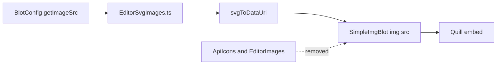

# Plan: In-browser SVG editor images (Issue #322)

## Requirements

### Overview & Goals
The transcription editor (Quill 1.3.7, `js/pages/PageViewer`) shows image embeds (chunk/chapter marks, line gaps, illegible, character gap, note mark, paragraph mark, no-word-break dash). Right now each image is a PNG made by PHP GD through authenticated `/api/images/*` endpoints (`ApiIcons` + `EditorImages`). The goal is to build these images in the browser as SVG and then delete the endpoints, without changing how Quill handles these embeds.

### Scope
**In scope**
- A new frontend module that builds an SVG for each of the 8 image types, with the same parameters, text, colours and rough sizes as `EditorImages.php`.
- Image blots get their `src` from a `data:image/svg+xml` URI instead of an API URL.
- Removing the backend: `ApiIcons.php`, `EditorImages.php`, `createApiImageRoutes()` in `app.php`, `www/fonts/fa-regular-400.ttf` and `www/fonts/NotoMono-Regular.ttf`, plus the matching entries in `docs/issues/ApiSiteInventory/inventory`.

**Out of scope**
- RTL image variants. Today the editor always asks for `ltr`, and that stays the same.
- Changes to Delta/EditorData format, blot attributes, popovers or toolbar.
- A visual redesign of the marks.

### User Stories
- As a transcriber, I want marks and gaps to look and behave as they do now, so that my workflow doesn't change.
- As a maintainer, I want to get rid of the GD-based image API (Issue #322), so that the backend is smaller and no request is made for each embed.

### Functional Requirements
- The editor makes no requests to `/api/images/...`.
- Each image type shows the same text and colours as before:
  - **chunkmark**: `START: <work>-<chunk>-<segment>[ (<lwid>)]` or `END: ...`, on background `#A5D0FF`, text `#32323C`. The local id is added only when it is not `A`.
  - **chaptermark**: `START CH: <work> Lvl <level>, n <number>` or `END CH: ...`, on background `#93BA95`.
  - **linegap**: `[ N line(s) not transcribed ]`, on `#F4F5F7`, text `#323232`.
  - **chgap**: N dots in grey `#C8C8C8`, transparent background.
  - **pmark**: `¶` in grey. **nowb**: `-` in grey.
  - **mark**: the Font Awesome *comment* (regular) glyph in red. **illegible**: N Font Awesome *eye-slash* (regular) glyphs in `#000AC8` on `#E6E6E6`.
- Images scale with the editor font size, using the current `size` formula `round(((fontSize-1)*0.2+1)*14)`.
- Line gaps still trigger line renumbering after their image loads.
- Saving and loading transcriptions gives exactly the same data as before.

### Non-Functional Requirements
- The images use no network and no web fonts. SVG inside `` can't load external resources, so icon glyphs are drawn as embedded paths and text uses a monospace font stack.
- Font Awesome Free path data is used under CC BY 4.0, with an attribution comment in the source.

## Technical Design

### Current Implementation
- [TranscriptionEditorBlots.js](../../apps/apm/www/js/pages/PageViewer/TranscriptionEditorBlots.js): `SimpleImgBlot` extends Quill `blots/embed` with `tagName = 'img'`. In `create()` it stores the Delta value in attributes such as `bltext`, `alttext` and `length`, then sets `src = this.getImageUrl(TranscriptionEditor.baseUrl, size, value)`. `value()` reads the attributes back, so `src` never goes into the Delta.
- [TranscriptionEditorBlotConfig.js](../../apps/apm/www/js/pages/PageViewer/TranscriptionEditorBlotConfig.js): each `registerImageBlot(...)` call passes a `getImageUrl(baseUrl, size, value)` that builds an `/api/images/...` URL.
- [TranscriptionEditor.js](../../apps/apm/www/js/pages/PageViewer/TranscriptionEditor.js):
  - `registerImageBlot` copies `getImageUrl` onto the blot class, with a default of `'urlnotset'`.
  - `setFontSize` updates `jsClass.size`.
  - `setOnLoadCallback` renumbers lines when an `` fires `load`. This is used by `linegap`.
- Backend:
  - [ApiIcons.php](../../apps/apm/www/classes/APM/Api/ApiIcons.php) calls [EditorImages.php](../../apps/apm/www/classes/APM/Api/EditorImages.php), which renders the PNGs with GD and the TTFs in `www/fonts`.
  - The routes are registered in `createApiImageRoutes()` in [app.php](../../apps/apm/www/classes/app.php) and called at line 211.
- CSS selectors such as `img.chunkmark`, `img.chaptermark` and `.editor-container img.linegap` live in `css/transcription-editor.css`.

### Key Decisions
- **Keep the `` node and use an SVG data URI** (chosen by the user). Only the value of `src` changes. The blot DOM, Quill embed guards, Delta round trip, popovers, CSS and the `load` callback all stay the same. Data-URI images still fire `load` asynchronously, so the listener added after `src` is set in `create()` still runs.
- **Embed the Font Awesome path data** (chosen by the user) for `comment` (regular, f075) and `eye-slash` (regular, f070). The source is FA Free 5.x SVG, and the paths are rendered through `<path transform>` scaled to the glyph size.
- **Measure text without the DOM.** Mono text is drawn with `font-family="Noto Mono, DejaVu Sans Mono, Menlo, Consolas, monospace"`. Width is computed as `chars × 0.6 × fontPx`, and `textLength` with `lengthAdjust="spacingAndGlyphs"` makes the text fit that width with any fallback font. The output is deterministic and can be unit-tested under Node.
- **Size calibration.** GD's `imagettftext` takes the size in points at 96 dpi, so `fontPx = factor × size × 4/3`. The canvas uses the same padding as PHP (chunk mark: height `size+5`, width `text+7`; line gap: height `size+8`, width `text+5`; and so on).
- **Rename the hook to `getImageSrc(size, value)`**, since it no longer needs `baseUrl`. This makes it clear that it returns a data URI.

### Data Models / Contracts
New TypeScript module `js/pages/PageViewer/EditorSvgImages.ts`:
```ts
export type MarkType = 'start' | 'end'
export interface ChunkMarkOptions { size: number; workId: string; chunkNumber: number|string; segment: number|string; type: MarkType; localWitnessId?: string }
export interface ChapterMarkOptions { size: number; workId: string; level: number|string; number: number|string; type: MarkType }
export function markSvg(size: number): string
export function noWordBreakSvg(size: number): string
export function illegibleSvg(size: number, length: number): string
export function chunkMarkSvg(options: ChunkMarkOptions): string
export function chapterMarkSvg(options: ChapterMarkOptions): string
export function lineGapSvg(size: number, count: number): string
export function characterGapSvg(size: number, length: number): string
export function paragraphMarkSvg(size: number): string
export function svgToDataUri(svg: string): string   // 'data:image/svg+xml;charset=utf-8,' + encodeURIComponent(svg)
```
- Every SVG has explicit `width`/`height` attributes, so the `` keeps its natural size, and an `xmlns`.
- All text is XML-escaped, because work ids and local ids come from user data.
- Numeric inputs are parsed with `parseInt`, with fallbacks such as `length >= 1`.

Blot contract (in `TranscriptionEditorBlots.js`):
```js
node.setAttribute('src', this.getImageSrc(size, value))
```

### Architecture Diagram

When a blot is created, `SimpleImgBlot.create()` calls the `getImageSrc` hook set in the blot config. The hook calls the matching `EditorSvgImages` builder, turns the result into a data URI and sets it as the `img` `src`. The PHP image API is no longer involved.

### File Structure
- Added: `apps/apm/www/js/pages/PageViewer/EditorSvgImages.ts`
- Added: `apps/apm/www/test/js/pages/PageViewer/EditorSvgImages.test.ts`
- Modified: `TranscriptionEditorBlotConfig.js`, `TranscriptionEditorBlots.js`, `TranscriptionEditor.js` (`registerImageBlot`)
- Modified: `apps/apm/www/classes/app.php` (remove `createApiImageRoutes` and its call)
- Modified: `docs/issues/ApiSiteInventory/inventory` (remove `/api/images/*` entries)
- Deleted: `apps/apm/www/classes/APM/Api/ApiIcons.php`, `apps/apm/www/classes/APM/Api/EditorImages.php`, `apps/apm/www/fonts/fa-regular-400.ttf`, `apps/apm/www/fonts/NotoMono-Regular.ttf`

### Risks
- **Small differences in look** (fallback mono font, anti-aliasing). `textLength` keeps widths stable, and only colours, text and dimensions need to match.
- **Line numbering** depends on the `load` event. Data URIs still fire it, and this is checked manually or in a happy-dom test.
- **`TranscriptionEditor.baseUrl`** is still set in `init()` and kept for other uses. Only the image hook stops using it.

## Testing

### Validation Approach
- Unit-test `EditorSvgImages.ts` with Vitest. The builders are pure, so their output can be parsed with `DOMParser` under happy-dom and checked.
- Run the full JS suite (`scripts/apm-test-js`) and the PHP suite (`scripts/apm-composer test`) and phpstan after the backend is removed, so that no class references are left behind.
- Do a final search to confirm there are no `api/images`, `ApiIcons` or `EditorImages` references left.

### Key Scenarios
- `chunkMarkSvg` start/end shows `START: AW1-3-2`, `END: AW1-3-2`, and `START: AW1-3-2 (B)` for `lwid=B` (and no suffix for `A`). Background is `#A5D0FF`.
- `chapterMarkSvg` shows `START CH: AW00 Lvl 1, n 2`.
- `lineGapSvg(size, 5)` shows `[ 5 line(s) not transcribed ]`. Height is `size+8`.
- `illegibleSvg(size, 3)` contains 3 eye-slash paths. `markSvg` contains the comment path in red.
- `characterGapSvg(size, 4)` shows 4 dots, and its width grows with length.
- The width/height attributes grow with `size`.
- `svgToDataUri` returns the `data:image/svg+xml` prefix and decodes back to the same SVG.

### Edge Cases
- Text containing `<`, `&` or `"` is escaped, and the SVG still parses.
- Length/count values arrive as strings from DOM attributes, and zero or invalid values are handled.
- Unicode `¶` survives data-URI encoding.

### Test Changes
- Add `apps/apm/www/test/js/pages/PageViewer/EditorSvgImages.test.ts`.
- There are no existing PHP tests for `ApiIcons`, so none need removing.

## Delivery Steps

### Step 1: Commit the plan as Markdown under docs/issue322
The repository has an initial commit that contains this plan at `docs/issue322/EditorSvgImagesPlan.md`.

- Create `docs/issue322/EditorSvgImagesPlan.md` with the Requirements, Technical Design, Testing and Delivery Steps sections. Leave out the frontmatter and use repo-relative paths instead of air-file links.
- Stage only that file and commit it following `policies/CommitMessageStyle.md`, for example `Add plan for in-browser SVG editor images` with the footer `Refs #322`.
- Each later step ends with one focused commit that contains only that step's changes.

### Step 2: Implement EditorSvgImages SVG builders with unit tests
There is a tested TypeScript module that builds SVG strings and data URIs for all 8 editor image types.

- Create `apps/apm/www/js/pages/PageViewer/EditorSvgImages.ts` with `markSvg`, `noWordBreakSvg`, `illegibleSvg`, `chunkMarkSvg`, `chapterMarkSvg`, `lineGapSvg`, `characterGapSvg`, `paragraphMarkSvg` and `svgToDataUri`. Use typed options objects for chunk and chapter marks.
- Port the text, colours, padding and size factors from `EditorImages.php`:
  - Convert GD points to pixels with a ×4/3 factor.
  - Compute mono width as `chars × 0.6 × fontPx` and apply it with `textLength`.
- Embed the Font Awesome Free regular `comment` and `eye-slash` path data with a CC BY 4.0 attribution comment. Scale them with `transform`.
- XML-escape all text and parse numeric inputs defensively.
- Add `apps/apm/www/test/js/pages/PageViewer/EditorSvgImages.test.ts` covering the key scenarios and edge cases. Run it with `scripts/apm-test-js`.
- Commit, for example `Add in-browser SVG builders for editor images` with the footer `Refs #322`.

### Step 3: Switch Quill image blots to SVG data URIs
The transcription editor shows all image embeds from in-browser SVG and makes no `/api/images` requests.

- In `TranscriptionEditor.registerImageBlot`, replace the `getImageUrl` option with `getImageSrc(size, value)` and give it a safe default (an empty SVG data URI).
- In `SimpleImgBlot.create()` in `TranscriptionEditorBlots.js`, set `src` from `this.getImageSrc(size, value)`. The `` tag, attributes, popover and `setOnLoadCallback` stay unchanged.
- In `TranscriptionEditorBlotConfig.js`, rewrite the 8 hooks (nowb, pmark, chgap, mark, illegible, chunkmark, chaptermark, linegap) to call the `EditorSvgImages` builders and `svgToDataUri`. They map `value.text`, `value.target`, `value.extrainfo`, `value.thelength` and `value.alttext` the same way the current URLs do.
- Confirm that no frontend code still references `api/images`. Run the JS test suite.
- Commit, for example `Render transcription editor images as SVG data URIs` with the footer `Refs #322`.

### Step 4: Remove backend image API, fonts and inventory entries
The PHP image endpoints and their font assets are gone, and the backend tests and static analysis still pass.

- Delete `apps/apm/www/classes/APM/Api/ApiIcons.php` and `apps/apm/www/classes/APM/Api/EditorImages.php`.
- Remove `createApiImageRoutes()` and its call in `createApiAuthenticatedRoutes()` from `apps/apm/www/classes/app.php`, along with the now-unused `ApiIcons` import.
- Delete `apps/apm/www/fonts/fa-regular-400.ttf` and `apps/apm/www/fonts/NotoMono-Regular.ttf`, after checking with a search that nothing else references them.
- Remove the `/api/images/*` entries from `docs/issues/ApiSiteInventory/inventory`.
- Run `scripts/apm-composer test` (and phpstan if available), then do a final repo-wide search for `ApiIcons`, `EditorImages` and `api/images`.
- Commit, for example `Remove server-side editor image API and fonts` with the footer `Closes #322`.