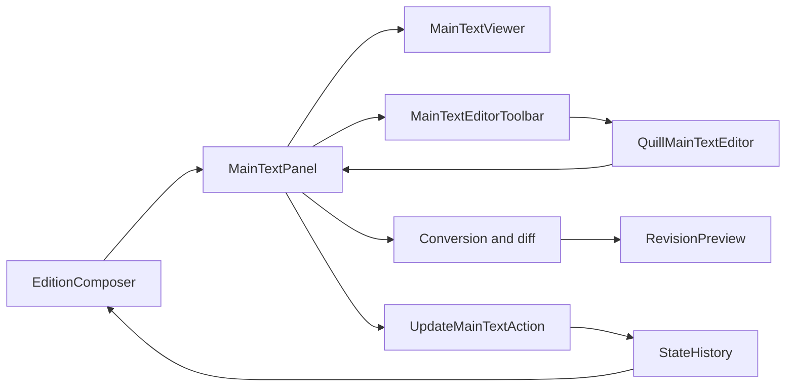

# Requirements

### Goal
Bring React `MainTextPanel.tsx` to parity with vanilla `EditionComposer/MainTextPanel.ts`, except apparatus-entry editing, which is explicitly deferred.

Intended Markdown document: `docs/issues/171 - React EditionComposer/MainTextPanel Implementation Plan.md`. This planning-only session cannot write project files; the submitted proposal supplies its content.

### Included behavior
- Provide Off, Apparatus, and Text modes with React toolbar controls. Preserve viewer line numbering, language styling, resize handling, apparatus-hover highlighting, and selected-lemma highlighting.
- Restore apparatus-entry highlighting and popovers, controlled by independent view toggles. Popovers show associated apparatuses, lemma/range information, and subentries.
- In Apparatus mode, support token-range selection, including backwards dragging, selection clearing, and ignoring whitespace as selection endpoints. Maintain correct mappings between main-text indices and collation indices.
- In Text mode, edit the entire main text using the installed Quill editor inside a React component. A **different React component** owns the formatting toolbar and controls the wrapper.
- Match existing bold, italic, numbering-label, small-font, superscript, headings 1–3, and language-specific character controls. Preserve RTL behavior and formatting-button state.
- Provide automatic numbering-label detection and Hebrew smart-quotation detection with legacy defaults. Recompute revisions when either setting changes.
- Show calculation status, change count, collapsible Revisions and Collation Table Changes, and appropriate Commit/Revert availability. Detect formatting-only changes as well as textual changes.
- Revert restores the committed baseline without modifying history. Commit applies the latest valid revisions as one undoable action and returns to Off, as in the legacy implementation.
- Respect the composer's existing editing restrictions and operational-versus-programming error handling. Drafts do not change committed collation data or the composer's unsaved-history indicator.

### Deliberate exclusions
- Reserve **`ApparatusEntryEditor`** as the future component responsible for apparatus-entry editing. Do not specify its interface, implementation, validation, or persistence yet; do not expose working add/edit controls until that component exists.
- Do not migrate unrelated composer functions, implement the current Save/archive stubs, change backend APIs, add dependencies, or port jQuery UI infrastructure.
- Preserve legacy mode-transition semantics: leaving Text discards uncommitted edits; switching panel tabs alone does not commit them.

# Technical Design

### Existing implementation
Paths below use `../../../apps/apm/www/js`, the source location found in this checkout.

- React `ReactAPM/Pages/EditionComposer/MainTextPanel/MainTextPanel.tsx` currently only connects `MainTextViewer` to collation-index mapping and line-number callbacks. `MainTextViewer.tsx` renders formatted tokens and tracks layout with `ResizeObserver`.
- Vanilla `EditionComposer/MainTextPanel.ts` contains modes, apparatus interactions, formatted-text/token conversion, throttled asynchronous diffing, revision previews, and aligned witness updates.
- `EditionComposer/EditionMainTextEditor.ts` provides the Quill configuration, custom blots, converters, and toolbar semantics, but constructs both editor and toolbar with jQuery. Reuse its underlying facilities rather than mounting this legacy widget inside React.
- `ReactAPM/Pages/EditionComposer/EditionComposer.tsx` already provides `canEdit`, guarded `runHistoryAction`, `StateHistory`, and edition regeneration through `CtDataEditionGenerator`. Existing actions such as `Actions/UpdateWitnessOrderAction.ts` deep-copy state before applying changes.
- `CtData/CtData.ts::insertColumnsAfter` updates the matrix, grouped columns, edition witness, and custom apparatus references together. `ReactAPM/Pages/MceComposer/MainTextPanel/MainTextPanel.tsx` demonstrates React Bootstrap token popovers.

### Ownership and flow
**Confirmed decision:** `MainTextPanel` owns its draft, parser settings, revision status, and asynchronous calculation lifecycle. `EditionComposer` remains the owner of committed state/history and shared apparatus interactions.

The panel captures a baseline when entering Text. Quill owns the live editing DOM; React must not repeatedly reset its contents on each change. The wrapper emits formatted text and selection/format state; the toolbar sends typed commands through an editor handle. Revision helpers contain no UI dependencies.



### Editing contracts
Use typed interfaces and discriminated unions, not `any`; typed options objects for APIs with four or more arguments.

```ts
type MainTextEditMode = 'off' | 'apparatus' | 'text';
type MainTextFormat =
  | 'bold' | 'italic' | 'numberingLabel' | 'small' | 'superscript';

interface QuillMainTextEditorHandle {
  focus(): void;
  setText(text: FmtText): void;
  getText(): FmtText;
  toggleFormat(format: MainTextFormat): void;
  toggleHeading(level: 1 | 2 | 3): void;
  insertCharacter(character: string): void;
}

type MainTextChange =
  | {change: 'replace'; index: number;
     currentToken: WitnessTokenInterface; newToken: WitnessTokenInterface}
  | {change: 'delete'; index: number; currentToken: WitnessTokenInterface}
  | {change: 'add'; index: number; newToken: WitnessTokenInterface};
```

`MainTextChange.index` is an original edition-witness/collation-column index, not a compacted visible-text position; additions at `-1` precede the first column. Add typed panel props for editing availability, apparatus display data, and an asynchronous commit callback returning success/failure. A commit request carries its revisions and captured baseline signature so stale state can be rejected. No contract for the deferred apparatus editor is included.

### Quill lifecycle and toolbar
- Instantiate the installed editor from `QuillLoader.ts` against a scoped DOM ref. Reuse `QuillDeltaRenderer`, `GenericQuillDeltaConverter`, `Small`, `Superscript`, `NumberingLabel`, and `ToolbarCharactersDefinition`; preserve paragraph conversion and blot ordering.
- Register custom formats through a small shared setup module safe for repeated mounts. Do not import the jQuery editor class to obtain registration side effects.
- Keep initial/reset content updates separate from user changes; detach editor listeners and clear owned resources on unmount. Verify development remounts do not duplicate handlers or toolbars.
- The toolbar contains no Quill instance or editable DOM. Track formats from selection and text changes; preserve/restore the last valid selection on button activation so commands act on the intended range. Use language character fallbacks instead of assuming every language has a character table.

### Parsing and revisions
Port the legacy conversion and change-list algorithms into typed helpers, using `EditionWitnessTokenStringParser`, `AsyncMyersDiff` from `toolbox/MyersDiff/AysncMyersDiff.ts`, and `TokenMatchScorer`.

Preserve glue/paragraph marks, headings, explicit numbering labels, supported inline attributes, token consolidation, punctuation, quote parsing, and existing normalization metadata. Apply `automaticNormalizationsApplied` using the existing normalizer implementations and the behavior of vanilla `EditionComposer.applyNormalizationsToWitnessToken`; do not instantiate the legacy composer. Copy formatted tokens before adding classes so editing cannot mutate the generated edition.

Filter empty tokens for diffing while retaining original indices. Preserve replacement grouping and ordering around insertions/deletions. Compare both tokens' format attributes correctly: the legacy equality code reads `x[attribute]` for both sides in one branch; do not reproduce that formatting-change bug.

Use the legacy approximately 500 ms change throttle, plus a monotonically increasing calculation/session identifier. Abort superseded work and ignore stale completions even when abort finishes asynchronously. Commit is unavailable while pending, failed, cancelled, empty, or based on a different baseline. Revert, mode exit, unmount, and committed-state changes invalidate pending results. Unrelated parent renders must not erase a draft; history/version changes invalidate it and reinitialize from current committed text.

Render revision previews declaratively with `FmtTextRenderer`, not generated HTML, showing additions, deletions, replacements, and formatting-only changes. Provide explicit error/retry behavior instead of leaving the spinner running indefinitely.

### Commit and viewer integration
`UpdateMainTextAction` deep-copies history state, verifies the baseline, replaces tokens, turns deletions into empty edition tokens, and inserts additions with `CtData.insertColumnsAfter`, accounting for columns inserted earlier in the same action. Never replace the witness wholesale or remove collation columns for deletions.

The composer executes this action through `runHistoryAction` and regenerates the edition. Only success clears the draft and returns to Off; failure retains it. Clear obsolete shared lemma/hover selections and line maps after changed content, then let the committed viewer report fresh numbering without callback loops. Quill's local draft undo is separate from committed composer history undo/redo.

For viewer parity, derive apparatus coverage from generated apparatus entry ranges. Keep persistent coverage highlighting separate from transient hover and selection. Implement popovers with React Bootstrap and formatted-text rendering, grouping overlapping entries by apparatus; include disabled-subentry presentation and witness sigla. Preserve main-text versus CT coordinate distinctions and current sibling-panel hover behavior.

### File structure
Relative to `../../../apps/apm/www/js`:
- Modify `ReactAPM/Pages/EditionComposer/EditionComposer.tsx` for props, committed action dispatch, and stale-selection cleanup.
- Modify `ReactAPM/Pages/EditionComposer/MainTextPanel/{MainTextPanel.tsx,MainTextViewer.tsx,MainTextPanel.css}`.
- Add `ReactAPM/Pages/EditionComposer/MainTextPanel/MainTextPanelToolbar.tsx` for mode/view/parser controls.
- Add `ReactAPM/Pages/EditionComposer/MainTextPanel/{QuillMainTextEditor.tsx,MainTextEditorToolbar.tsx,MainTextRevisionPreview.tsx,MainTextApparatusPopover.tsx}`; one functional component per file.
- Add scoped helper modules under that same directory for Quill setup, formatted-text conversion/normalization, and revision calculation.
- Add `ReactAPM/Pages/EditionComposer/Actions/UpdateMainTextAction.ts`.
- Add/update corresponding tests under `../../../apps/apm/www/test/js/ReactAPM/Pages/EditionComposer`, including component, helper, action, and composer integration coverage. Do not create or specify `ApparatusEntryEditor` yet.

# Testing

### Automated validation
Follow the existing Vitest tests with `happy-dom`, React `act`, and `createRoot`, particularly `MainTextViewer.test.tsx` and `EditionComposer.test.tsx`. Use deterministic Quill/diff mocks for panel orchestration and a real installed-Quill smoke test for wrapper/toolbar behavior where the environment supports it. Run `./scripts/apm-test-js` and relevant existing TypeScript/build checks; no PHP or API changes are planned.

### Required scenarios
- Text/FmtText/token round trips: plain text, multi-paragraph headings, all inline formats, explicit/detected labels, Hebrew quotation settings, configured normalizations, empty text, and RTL character insertion.
- Format-only changes, normalized-token comparisons, whitespace/empty-column handling, leading/trailing additions, mixed replacements/deletions/insertions, and multiple additions at one original index.
- Wrapper initialization, silent resets, toolbar active states, preserved selection, read-only operation, and listener cleanup on remount.
- Throttled rapid edits, overlapping calculations, abort/revert, errors, leaving Text, tab switching, unmount, version/history changes, and stale commit rejection.
- Action atomicity and input immutability; matrix dimensions, grouped columns, and custom apparatus references after insertion; deletions retain columns. One commit creates one history entry; undo/redo restores all affected data.
- Composer guards for archived/loading/bug/action-in-progress states, failed commits retaining drafts, return to Off on success, and generated viewer/apparatus updates.
- Viewer selection in both directions, whitespace endpoints, clearing selection, coverage/hover/selected-lemma distinction, overlapping apparatus popovers and toggles, line-number resize regression, and absence of state-update loops.

Apparatus-entry creation/editing tests remain deferred with `ApparatusEntryEditor`.

# Delivery Steps

###   Step 1: Restore panel modes and apparatus-aware viewing
MainTextPanel exposes React mode/view controls and restores legacy viewing and selection behavior without apparatus-entry editing.
- Add MainTextPanelToolbar and typed mode state in MainTextPanel.tsx.
- Extend MainTextViewer and panel CSS for apparatus coverage, hover, selection, and token-range interaction.
- Add MainTextApparatusPopover using existing React Bootstrap and FmtTextRenderer patterns.
- Supply generated apparatus data and editing guards from EditionComposer.tsx; keep entry add/edit unavailable pending ApparatusEntryEditor.
- Extend viewer/panel tests for toggles, range selection, overlapping entries, and stable line-number reporting.

###   Step 2: Introduce the Quill wrapper and independent formatting toolbar
Text mode edits formatted main text using Quill controlled by a separate React toolbar.
- Add QuillMainTextEditor, typed editor handle, and safe custom-format setup using the installed loader, blots, and converters.
- Add MainTextEditorToolbar with formatting, headings, and language-specific character controls.
- Implement baseline-to-editor conversion, selection preservation, silent reset, read-only state, and cleanup.
- Connect Text mode without committing draft changes; test conversion, editor lifecycle, toolbar state, and RTL insertion.

###   Step 3: Implement parsing and asynchronous revision previews
Draft changes produce accurate, cancellable previews and can be reverted without touching committed state.
- Add typed conversion/normalization and revision helpers porting the legacy parser, token consolidation, AsyncMyersDiff, and change-list grouping.
- Preserve original collation indices and detect formatting-only edits without carrying over the legacy attribute-comparison bug.
- Wire parser toggles, throttling, generation identifiers, cancellation, and error handling into MainTextPanel.
- Add MainTextRevisionPreview with count, Revisions, and Collation Table Changes sections; implement Revert and mode/history invalidation.
- Test normalization, change ordering, rapid edits, stale completion rejection, pending/error states, and draft restoration.

###   Step 4: Commit revisions through composer history
A valid text commit updates aligned collation data atomically as one undoable action and returns the panel to Off.
- Add UpdateMainTextAction following existing deep-copy StateTransformAction implementations.
- Apply replacements and empty-token deletions; insert additions via CtData.insertColumnsAfter with cumulative offsets and baseline validation.
- Connect the panel commit callback to EditionComposer.runHistoryAction, preserving drafts on failure and clearing stale shared selections after success.
- Reconcile generated edition, viewer numbering, undo/redo, session navigation, and existing edit guards.
- Add action/composer integration tests for matrix and apparatus-reference integrity, history behavior, atomic failure, and read-only states; run the JS suite and relevant existing build checks.